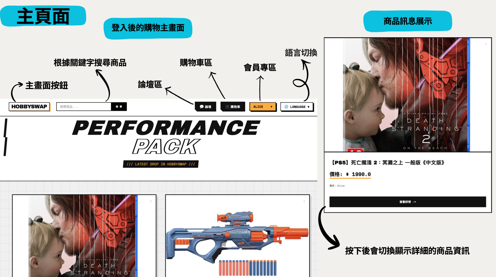
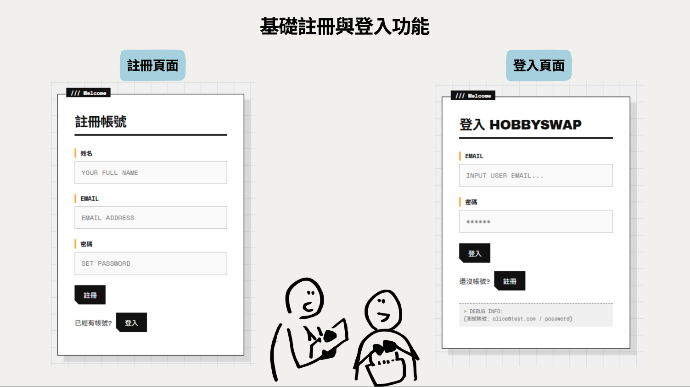
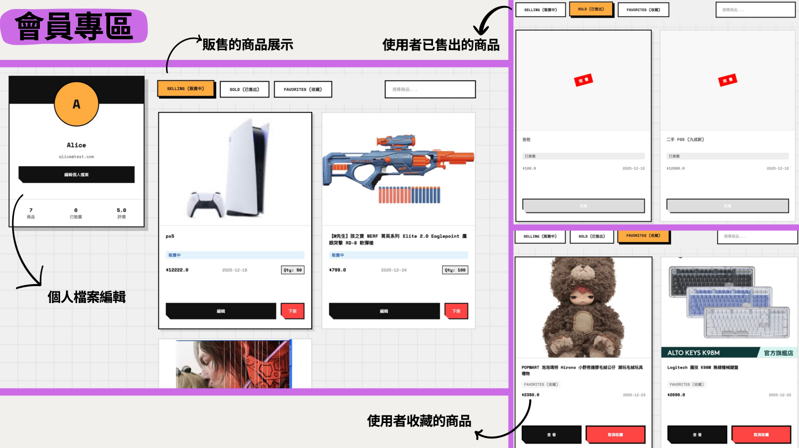
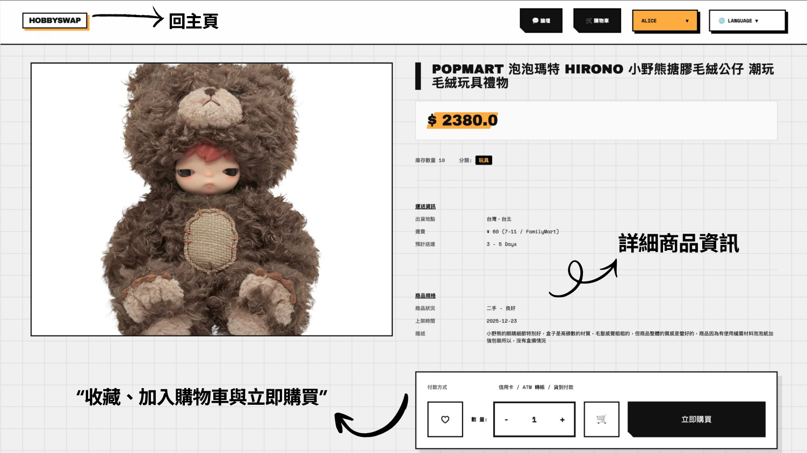
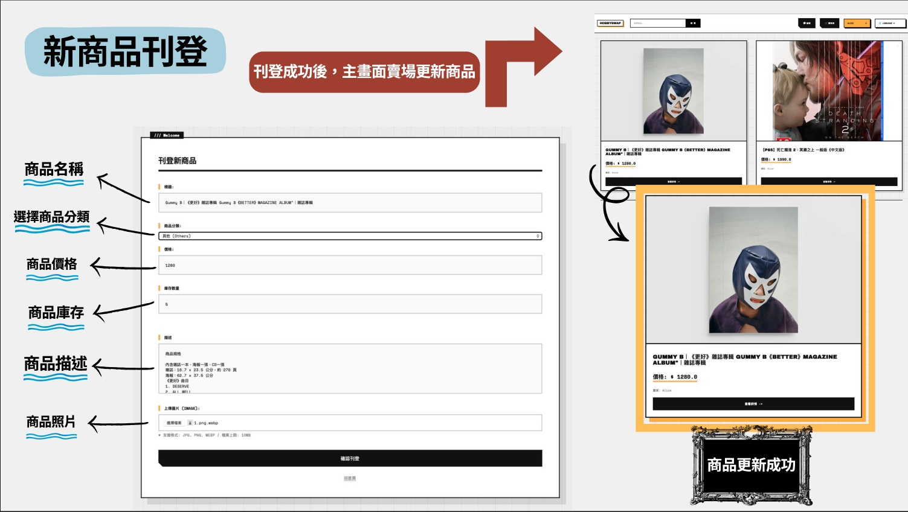
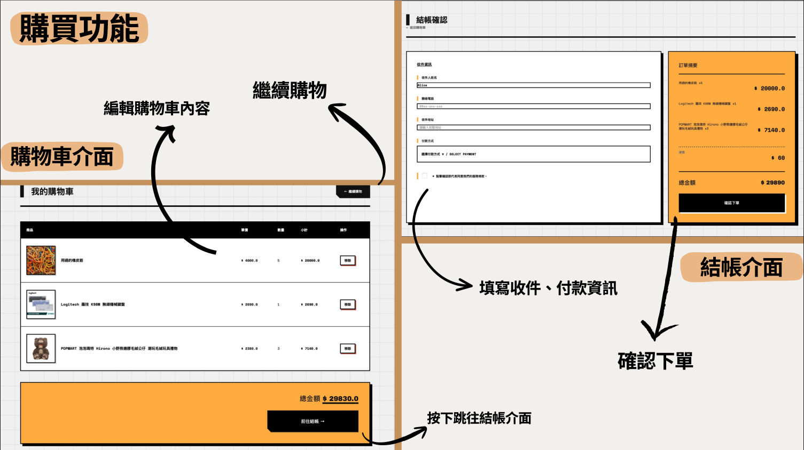
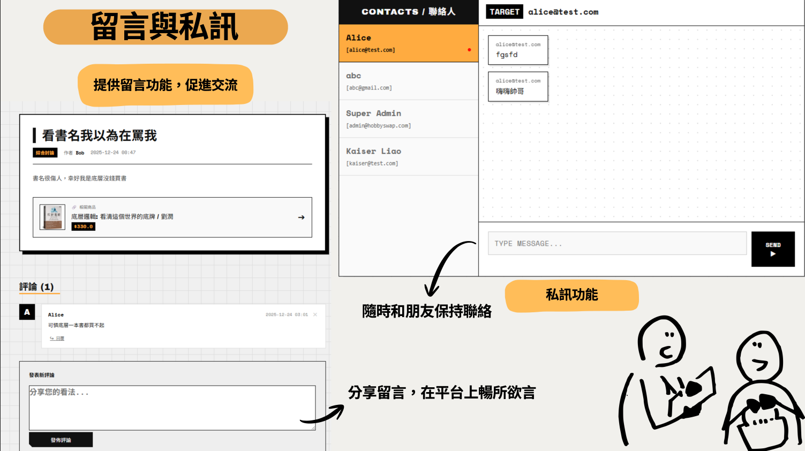
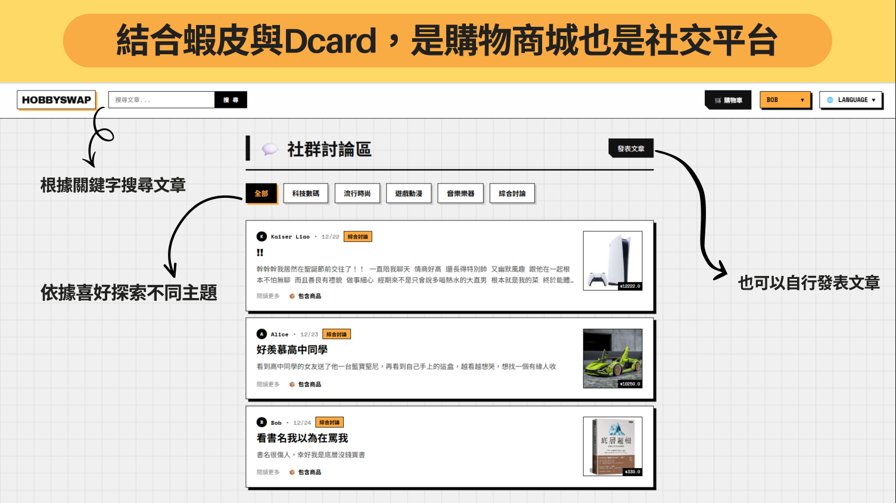
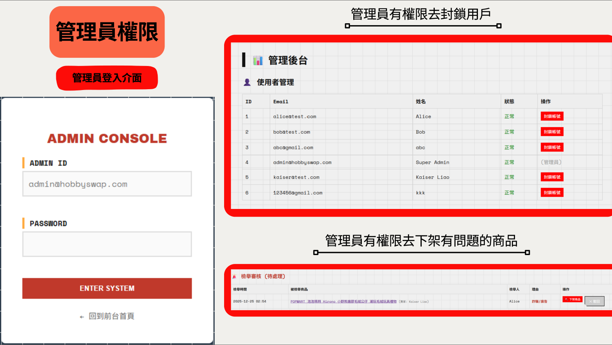

# HobbySwap 興趣交易平台

HobbySwap 是一個基於 Spring Boot 開發的線上社群與交易平台，專為擁有共同興趣的同好設計，提供物品買賣、論壇交流以及即時聊天等功能。

## 核心功能

* **會員系統**：註冊、登入與登出、重複 Email 檢查，以及個人首頁 (MyPage) 的刊登商品與已售出數量。
* **物品交易**：
  * 商品上架、瀏覽、關鍵字搜尋、收藏、評價與下架
  * 購物車加入、同商品數量合併與移除
  * 購物車結帳與直接購買，建立訂單並更新庫存
  * 購買數量須大於零，結帳不得超過庫存；庫存歸零時標記為售出
* **社群論壇**：文章發表、分類與搜尋、留言及回覆，以及作者刪除自己的內容。
* **即時通訊**：透過 WebSocket / STOMP 提供公共聊天室、私人聊天與訊息儲存；公共聊天紀錄排除私人訊息。
* **多語系支援**：預設繁體中文，可切換英文及日文。
* **後台管理**：管理員可封鎖與解除封鎖會員、強制下架商品、處理檢舉，以及管理 CSV 檔案資料。

訪客可瀏覽商品與論壇；商品刊登、購物、論壇發文等寫入操作需登入，後台限定管理員使用。

## 系統畫面


|                           主頁面                           |                                   基礎註冊與登入                                   |
| :---------------------------------------------------------: | :---------------------------------------------------------------------------------: |
|  |  |


|                            會員專區                            |                            商品頁面                            |
| :-------------------------------------------------------------: | :-------------------------------------------------------------: |
|  |  |


|                             新商品刊登                             |                            購買功能                            |
| :-----------------------------------------------------------------: | :-------------------------------------------------------------: |
|  |  |


|                             留言與私訊                             |                             社群討論區                             |
| :-----------------------------------------------------------------: | :-----------------------------------------------------------------: |
|  |  |


|                             管理員頁面                             |  |
| :-----------------------------------------------------------------: | :-: |
|  |  |

## 技術選型

* **後端架構**：Java 21, Spring Boot 3.5.8
* **安全機制**：Spring Security
* **資料存取**：Spring Data JPA
* **資料庫**：H2 Database
* **前端模板**：Thymeleaf, Thymeleaf Extras for Spring Security
* **即時通訊**：Spring Boot WebSocket
* **構建工具**：Maven / Maven Wrapper

## 資料儲存

一般啟動時，資料以以下方式儲存在本機，程式關閉後仍會保留。相對路徑以執行時的工作目錄為準；從專案根目錄啟動時，檔案位置如下：

1. **H2 資料庫（檔案模式）**：主要業務資料（會員、商品、訂單、論壇、聊天等）透過 Spring Data JPA
   寫入 H2 資料庫，而 H2 設定為「檔案模式」(`jdbc:h2:file:./data/hobbyswap`)，
   實際資料就儲存在專案根目錄的 **`data/hobbyswap.mv.db`** 這個檔案裡。

2. **純文字 CSV 檔（Java 原生檔案 I/O）**：另提供「檔案資料管理」功能，
   完全不使用資料庫，直接以 `BufferedReader` / `BufferedWriter` 對純文字檔
   **`data/records.csv`** 進行 **寫入(新增) / 讀取(列表) / 修改 / 刪除**：
   * 物件：[`FileRecord`](src/main/java/com/hobbyswap/model/FileRecord.java)
   * 檔案讀寫邏輯：[`FileRecordService`](src/main/java/com/hobbyswap/service/FileRecordService.java)
   * 進入頁面：以管理員身分登入後 → 後台儀表板 → 「🗂️ 檔案資料管理」按鈕（網址 `/admin/records`）
   * 管理員示範帳號：`admin@hobbyswap.com` / `admin123`

3. **商品圖片**：上傳檔案儲存在 `uploads/`，由 `/uploads/**` 提供存取；單一檔案及單次請求上限皆為 10 MB。

## 專案結構簡介

```text
src/main/java/com/hobbyswap/
├── config/       # Spring Configuration (Security, WebSocket, Web 等配置)
├── controller/   # Spring MVC Controllers (負責處理 HTTP 請求)
├── dto/          # Data Transfer Objects (資料傳輸物件)
├── model/        # JPA Entities (包含 User, Item, Cart, Order, ForumPost, ChatMessage 等實體模型)
├── repository/   # Spring Data JPA 介面 (資料存取層)
└── service/      # 業務邏輯層
src/main/resources/
├── static/       # 靜態資源 (CSS 等)
├── templates/    # Thymeleaf 前端頁面模板
└── application.properties # 系統運行配置設定
src/test/java/com/hobbyswap/
├── controller/   # 聊天控制器單元測試
├── service/      # 會員單元測試、交易整合測試與 CSV 檔案測試
├── CommunityAdminTest.java       # 論壇發文、作者權限與後台操作測試
├── WebAccessTest.java            # 網頁權限、表單驗證與語系切換測試
├── PrivateChatDeliveryTest.java  # 雙使用者 WebSocket 私訊整合測試
└── HobbySwapApplicationTests.java # Spring 應用程式啟動測試
src/test/resources/
└── application-test.properties   # test profile 設定，使用記憶體 H2
```

## 快速開始

### 1. 安裝必備環境

如果您從未有過 Java 開發經驗，請先確認您的電腦已安裝以下基礎軟體：

* **Git**: 用來將專案程式碼下載到電腦裡 ([📥 點此下載 Git](https://git-scm.com/downloads))。
* **JDK 21**: 這是執行 Java 與 Spring Boot 必備的程式引擎。推薦下載免費的 Eclipse Temurin 21 ([📥 點此下載 JDK 21](https://adoptium.net/zh-TW/temurin/releases/?version=21))。
  *(※ 安裝 JDK 時，請記得勾選「設為系統環境變數/Add to PATH」)*
* **不需安裝 Maven**: 本專案已內建 `mvnw` (Maven Wrapper 工具)，系統會自動處理所有的套件！

### 2. 下載專案與建置

這一步將下載程式碼與相依套件，並編譯及打包專案。

1. **取得程式碼**：
   打開您的終端機 (Terminal / PowerShell / 命令提示字元)，複製並貼上以下指令：

   ```bash
   git clone https://github.com/shin321470/hobbyswap.git
   cd hobbyswap
   ```
2. **建置專案**：
   在專案根目錄執行以下指令。第一次執行會下載 Maven 與 `pom.xml` 中的相依套件，完成後應顯示 `BUILD SUCCESS`。

   * **Windows / PowerShell**:
     ```powershell
     .\mvnw.cmd clean verify
     ```
   * **Mac / Linux**:
     ```bash
     ./mvnw clean verify
     ```

### 3. 環境配置 (IDE 與設定檔)

1. **應用程式設定**：
   專案的核心設定檔位於 `src/main/resources/application.properties`。本專案的 H2 採用 **檔案模式 (file mode)**，所有資料會「持久化」寫入專案根目錄下的 `data/` 資料夾（例如 `data/hobbyswap.mv.db`），程式關閉後資料不會消失。您可依需求修改：

   ```properties
   # H2 資料庫設定 (檔案模式：資料實際存於 ./data/hobbyswap.mv.db 檔案中)
   spring.datasource.url=jdbc:h2:file:./data/hobbyswap
   spring.datasource.driverClassName=org.h2.Driver
   spring.datasource.username=sa
   spring.datasource.password=password

   # JPA/Hibernate 設定
   spring.jpa.hibernate.ddl-auto=update

   # 開啟 H2 控制台
   spring.h2.console.enabled=true
   ```
2. **開發工具 (IDE) 匯入**：

   * **IntelliJ IDEA**: 點選 `File -> Open`，選擇專案根目錄即可。IDEA 會自動識別 `pom.xml` 並下載 Maven 依賴。
   * **Eclipse**: 點選 `File -> Import -> Existing Maven Projects` 匯入。
   * **VS Code**: 建議安裝 `Extension Pack for Java` 和 `Spring Boot Extension Pack` 擴充套件，並直接開啟專案資料夾。

### 4. 啟動平台

環境、套件安裝齊全後，即可啟動這個購物平台！

1. 執行應用程式啟動指令：

   * **Windows / PowerShell**:
     ```powershell
     .\mvnw.cmd spring-boot:run
     ```
   * **Mac / Linux**:
     ```bash
     ./mvnw spring-boot:run
     ```

   *(請等候幾秒鐘，當看到類似 `Started HobbySwapApplication in xxx seconds` 的字樣，代表啟動成功了！)*
2. 開啟您的瀏覽器，並訪問以下網址：
   [http://localhost:8080](http://localhost:8080)
   (接下來，您可以嘗試註冊一個帳號，開始體驗平台的功能了！)

## 國際化

HobbySwap 支援多語系切換，位於 `src/main/resources/` 的 `.properties` 檔案負責管理：

* `messages.properties` - 繁體中文語系
* `messages_en.properties` - 英文語系
* `messages_ja.properties` - 日文語系

預設語系為繁體中文，可透過頁面語系選單，或在網址加入 `?lang=en`、`?lang=ja`、`?lang=zh_TW` 切換；選擇會保留在目前的 session。

## 已知限制與待完成項目

* MyPage 的商品「編輯」連結尚無對應處理流程，目前會回傳 404；「編輯個人檔案」按鈕也尚未接上功能。
* 結帳已建立並儲存訂單，買家訂單歷史與訂單管理頁面尚待實作。
* MyPage 評分目前固定顯示 5.0，頁尾部分資訊與社群連結仍為佔位內容。

## H2 資料庫主控台

在開發環境下，專案預設搭載了輕量級的 H2 資料庫。
如果 `application.properties` 中開啟了 H2 Console，您可以透過瀏覽器查看目前資料庫的 Table 結構與資料。

* 預設路徑：`http://localhost:8080/h2-console`
* 詳細連線資訊請參照 `application.properties` 內的配置。
